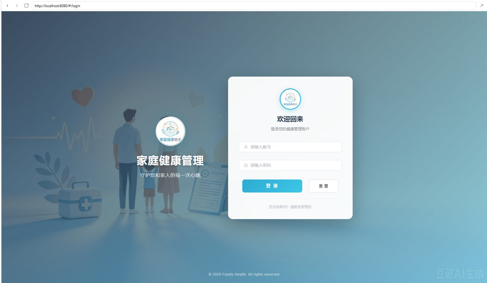
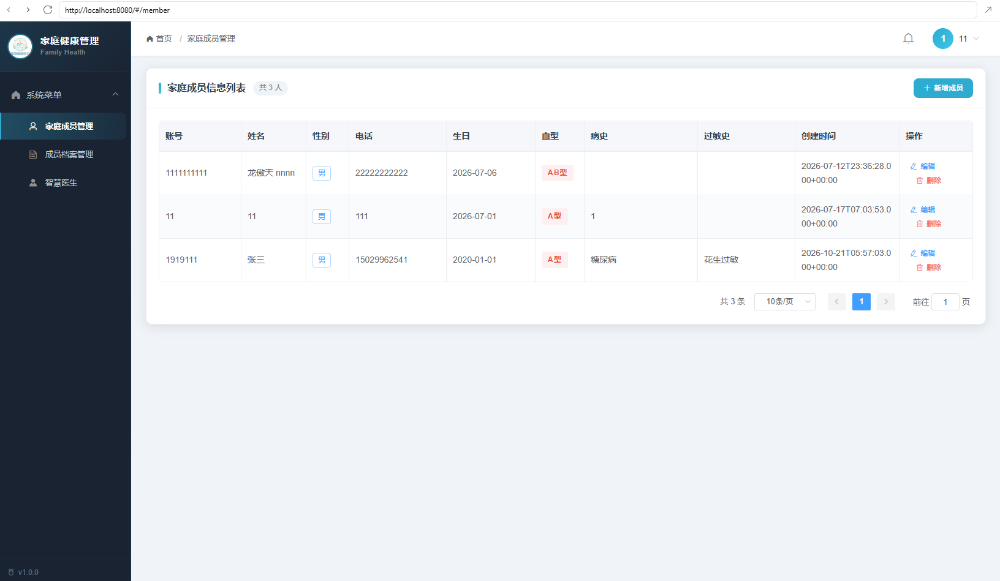
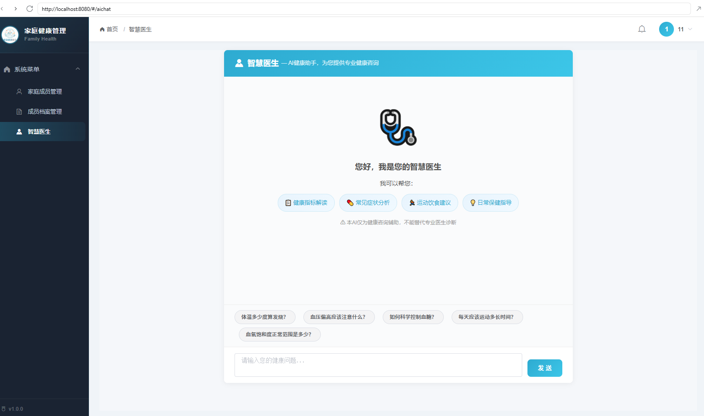

# 家庭健康助手 · Family Health Assistant

> 面向家庭的健康数据管理 Web 应用：记录体温 / 血压 / 血氧 / 血糖 / 体重等指标，并接入 DeepSeek 大模型提供「智慧医生」健康咨询。


---

## 目录

- [功能](#功能)
- [运行截图](#运行截图)
- [技术栈](#技术栈)
- [快速开始](#快速开始)
- [环境变量](#环境变量)
- [接口一览](#接口一览)
- [几个值得说的设计](#几个值得说的设计)
- [目录结构](#目录结构)
- [已知不足与后续计划](#已知不足与后续计划)

---

## 功能

| 模块 | 说明 |
| --- | --- |
| 🔐 登录认证 | 账号密码登录，签发 JWT，拦截器统一校验，前端 Axios 拦截器自动携带 Token |
| 👨‍👩‍👧‍👦 家庭成员 | 成员的增删改查；记录性别、血型、生日、病史、过敏史；列表分页 |
| 📋 健康档案 | 体温 / 高压 / 低压 / 血氧 / 体重 / 血糖 / 备注；按记录时间倒序分页 |
| 🎨 指标预警 | 前端按阈值给数值上色：体温 ≥37.3℃ 标红、血糖 >7.0 或 <3.9 标红 |
| 🤖 智慧医生 | 对接 DeepSeek（OpenAI 兼容接口），System Prompt 设定角色，多轮对话带上下文 |
| 🔒 数据隔离 | 健康记录按当前登录用户过滤，接口层带归属校验，防止越权读到别人的数据 |

---

## 运行截图

**登录页** —— JWT 鉴权、失败返回 401 而不是 200 + null



**家庭成员管理** —— 分页、按性别/血型标签展示



**智慧医生** —— 对接 DeepSeek，System Prompt 设定角色，多轮对话带上下文



---

## 技术栈

**后端**：Java 17 · Spring Boot 3.5 · MyBatis 3（XML 映射）· MySQL 8 · JWT（java-jwt）· Maven

**前端**：Vue 2.6 · Vue Router 3 · Element UI 2.15 · Axios 1.x · vue-cli 3

**AI**：DeepSeek Chat API（OpenAI 兼容格式）· RestTemplate 直连 · System Prompt 角色设计

**架构**：前后端分离，Controller → Service → Mapper 三层，JWT 无状态鉴权

```
Vue + Element UI
      │  Axios（请求头带 token）
      ▼
Spring Boot REST API ── TokenInterceptor 校验 JWT
      │
      ▼
Service（业务 + 密码哈希 + 分页计算）
      │
      ▼
MyBatis XML ──► MySQL
      │
      └──► DeepSeek Chat API（AI 对话）
```

---

## 快速开始

### 0. 先确认这四样都装好了

| 依赖 | 版本 | 怎么确认 |
| --- | --- | --- |
| JDK | **17** | `java -version` 输出 `17.x` |
| Maven | 3.6+ | `mvn -v` 有输出。**项目没附 `mvnw`，必须自己装** |
| MySQL | 8.0+ | `mysql --version` 有输出，且服务已启动 |
| Node.js | **16.x** | `node -v`。17 及以上见下面的警告 |

> ⚠️ **Node 17 及以上必看**
>
> 前端是 vue-cli 3（webpack 4），在 Node 17+ 上会报：
>
> ```
> Error: error:0308010C:digital envelope routines::unsupported
> ```
>
> 两个办法任选其一：
>
> - 换成 Node 16：`nvm use 16`（推荐）
> - 或者每次启动前放宽 OpenSSL：PowerShell 执行 `$env:NODE_OPTIONS="--openssl-legacy-provider"`，macOS / Linux 执行 `export NODE_OPTIONS=--openssl-legacy-provider`

### 1. 建库建表

确认终端当前目录是**项目根目录**（`ls` 或 `dir` 能看到 `docs` 文件夹），然后：

```bash
mysql -u root -p -e "source docs/schema.sql"
```

> ⚠️ **别用 `mysql -u root -p < docs/schema.sql`**
>
> PowerShell 不支持 `<` 输入重定向；而 `Get-Content docs/schema.sql | mysql` 会把文件里的中文注释
> 按 GBK 转码，直接报 `ERROR 1064 ... check the manual ... near '性别'`。
> `-e "source ..."` 是让 mysql 客户端自己读文件，不经过终端编码，Windows / macOS / Linux 都稳。

执行完验证一下：

```bash
mysql -u root -p -e "use familyhealthdb; show tables;"
```

应该看到 `member`、`record` 两张表。

### 2. 启动后端

```powershell
cd backend

# 数据库账号密码（改成你自己的）
$env:DB_USERNAME="root"
$env:DB_PASSWORD="你的MySQL密码"

# JWT 签名密钥，至少 32 位
$env:JWT_SECRET="随便一串至少32位的字符"

# 可选：不配也能启动，只是「智慧医生」会提示未配置
$env:AI_API_KEY="sk-你的DeepSeekKey"

mvn spring-boot:run
```

macOS / Linux 把 `$env:XXX="..."` 换成 `export XXX=...` 即可。

看到这两行就成功了：

```
Tomcat started on port 8088 (http)
Started FamilyHealthApplication in 2.7 seconds
```

验证：浏览器打开 <http://127.0.0.1:8088/loginweb/test>，返回 `success`。

> 首次启动且 `member` 表为空时，会自动创建演示账号 **demo / 123456**，密码以 PBKDF2 哈希入库。

### 3. 启动前端

**另开一个终端**（后端那个别关）：

```powershell
cd frontend
npm install
npm run serve
```

看到 `Compiled successfully` 和 `App running at: http://localhost:8080/` 就成了。

打开 <http://localhost:8080>，用 `demo / 123456` 登录。

> 前端请求地址在 `frontend/src/main.js` 的 `axios.defaults.baseURL`（`http://127.0.0.1:8088/`），
> 后端换端口时记得同步改。

### 4. 跑不通？对照这张表

| 现象 | 原因 | 解决 |
| --- | --- | --- |
| `ERROR 1064 ... near '性别'` | SQL 文件被终端按 GBK 转码了 | 改用 `-e "source docs/schema.sql"`，别用管道 |
| `Unknown database 'familyhealthdb'` | 没建库 | 回到第 1 步 |
| `CannotGetJdbcConnectionException` | 库名或密码不对 | 检查 `DB_PASSWORD` / `DB_URL` |
| `Access denied for user 'root'` | MySQL 密码错 | 换成你自己的密码 |
| `error:0308010C` | Node 17+ | 见第 0 步的警告 |
| `'mvn' 不是内部或外部命令` | 没装 Maven | 装 Maven 3.6+ 并加到 PATH |
| 登录提示「账号或密码错误」 | 库里有旧数据，演示账号没被创建 | 用库里已有的账号，或清空 `member` 表后重启 |
| 前端页面空白 / 一直转圈 | 后端没起或端口不一致 | 先确认 `loginweb/test` 返回 `success` |

---

## 环境变量

配置文件里所有敏感项都是 `${ENV:默认值}` 形式，**仓库中不含任何真实密钥**。

| 变量 | 默认值 | 说明 |
| --- | --- | --- |
| `SERVER_PORT` | `8088` | 后端端口 |
| `DB_URL` | 本机 `familyhealthdb` | JDBC 连接串 |
| `DB_USERNAME` | `root` | 数据库账号 |
| `DB_PASSWORD` | `123456` | 数据库口令（默认值仅供本地开发） |
| `JWT_SECRET` | 开发用占位串 | **必须覆盖**，至少 32 位随机串 |
| `ALLOW_LEGACY_PLAINTEXT` | `true` | 迁移期开关，允许老库里的明文密码登录并自动升级为哈希；迁移完成后设为 `false` |
| `AI_API_KEY` | 空 | DeepSeek API Key，为空时「智慧医生」会提示未配置 |
| `AI_API_URL` | `https://api.deepseek.com/v1/chat/completions` | 兼容任何 OpenAI 格式的接口 |
| `AI_API_MODEL` | `deepseek-chat` | 模型名 |
| `DEMO_ACCOUNT_ENABLED` | `true` | 是否在空库时自动创建演示账号 |

---

## 接口一览

除 `/loginweb/**` 外，所有接口都需要在请求头里带 `token`。

| 方法 | 路径 | 说明 |
| --- | --- | --- |
| POST | `/loginweb/login` | 登录，成功返回用户信息 + token；失败返回 **401** |
| GET | `/loginweb/test` | 探活 |
| GET | `/memberweb/members?page=1&size=10` | 成员列表（分页） |
| POST | `/memberweb/saveMember` | 新增成员（密码默认 123456，哈希入库） |
| GET | `/memberweb/member/{id}` | 单条查询（编辑回显） |
| PUT | `/memberweb/updateMember` | 更新成员资料（不修改密码） |
| DELETE | `/memberweb/members/{id}` | 删除成员 |
| GET | `/health/all?page=1&size=10` | 健康记录列表（分页，按登录用户隔离） |
| POST | `/health/save` | 新增健康记录 |
| GET | `/health/{id}` | 单条健康记录 |
| POST | `/health/update` | 更新健康记录 |
| DELETE | `/health/{id}` | 删除健康记录 |
| POST | `/aichat/chat` | AI 对话，body：`{"messages":[{"role":"user","content":"..."}]}` |
| GET | `/aichat/health` | AI 服务状态（是否已配置 Key） |

> 单条记录的查 / 改 / 删，如果 id 不存在、或者存在但不属于当前登录用户，统一返回 **404**——
> 刻意不区分这两种情况，避免用响应差异探测某条记录是否存在。

分页接口统一返回：

```json
{
  "total": 42,
  "page": 1,
  "size": 10,
  "pages": 5,
  "records": []
}
```

---

## 几个值得说的设计

**1. 密码不落地明文**
新增成员时密码统一哈希（PBKDF2-HMAC-SHA256，16 字节随机盐，12 万次迭代），存储格式 `pbkdf2$迭代次数$盐$摘要`。之所以不用 BCrypt，是因为不想为它引入整个 `spring-security-crypto`；PBKDF2 是 JDK 自带的，效果等价。将来换成 `BCryptPasswordEncoder` 时只需要改 `PasswordHasher`，调用方不用动。

**2. 明文存量密码平滑迁移**
老库里存的是明文，直接改成哈希会让所有人登不进来。做法是：校验时如果发现存的值不是哈希串，就在迁移开关打开的前提下按明文比对，比对成功后立刻把哈希写回数据库。迁移完把 `ALLOW_LEGACY_PLAINTEXT` 关掉即可。

**3. 密码永远不出现在响应里**
登录成功、成员列表、编辑回显，返回前都会把 `password` 置空；SQL 也改成显式列名，不再 `select *`。

**4. 分页没有引插件**
用 `LIMIT offset, size` + `COUNT(*)` 两步手动实现，包一层 `PageResult`。好处是 SQL 一眼能看懂、依赖少；`size` 上限锁在 100，避免被人用 `size=999999` 打成全表扫描。

**5. AI 调用要能兜住**
`RestTemplate` 默认没有超时，上游一卡线程就挂住了，所以显式设了 5s 连接 / 60s 读取。未配置 Key 时返回明确提示而不是抛异常；对话接口限制单次 40 条消息、单条 4000 字，防止上下文无限膨胀把 token 烧完。

**6. 错误语义要对**
原来登录失败返回 `200 + null`，前端只能猜。现在返回 `401 + JSON`，前端就能区分「密码错了」和「网络断了」。全局异常统一返回 `{code, message}`，异常原文只进日志，不透给客户端。

---

## 目录结构

```
.
├── backend/                       # Spring Boot 后端
│   ├── pom.xml
│   └── src/main/
│       ├── java/com/example/familyhealth/
│       │   ├── commom/            # JWT、拦截器、CORS、密码哈希、分页结构、全局异常
│       │   ├── mapper/            # MyBatis 接口
│       │   ├── model/             # 实体
│       │   ├── service/           # 业务逻辑（含 AI 对话服务）
│       │   └── web/               # REST 控制器
│       └── resources/
│           ├── application.properties
│           └── mapper/*.xml       # MyBatis SQL 映射
├── frontend/                      # Vue 2 前端
│   └── src/
│       ├── Login.vue / Main.vue
│       ├── router/index.js
│       └── view/{member,record,aichat}/
├── docs/
│   └── schema.sql                 # 建库建表脚本
└── README.md
```

---

## 已知不足与后续计划

- [ ] 健康指标趋势图（ECharts）
- [ ] AI 对话历史持久化（现在刷新页面会丢上下文）
- [ ] 角色与权限（目前只有登录/未登录两种状态）
- [ ] 分页排序参数化（目前固定按 id / 时间倒序）
- [ ] Service 层单元测试（目前只覆盖了 PasswordHasher）
- [ ] 前端组件拆分（列表页偏大，可抽出可复用的表格组件）

---

## 使用说明

本项目开源仅供学习交流，未经允许请勿用于商业用途。
